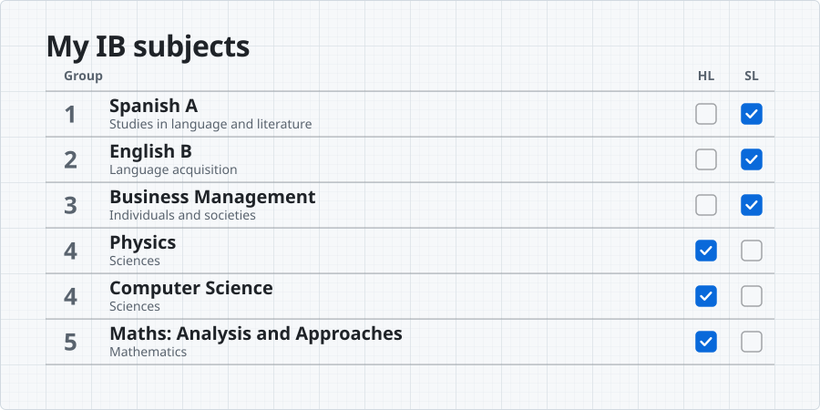
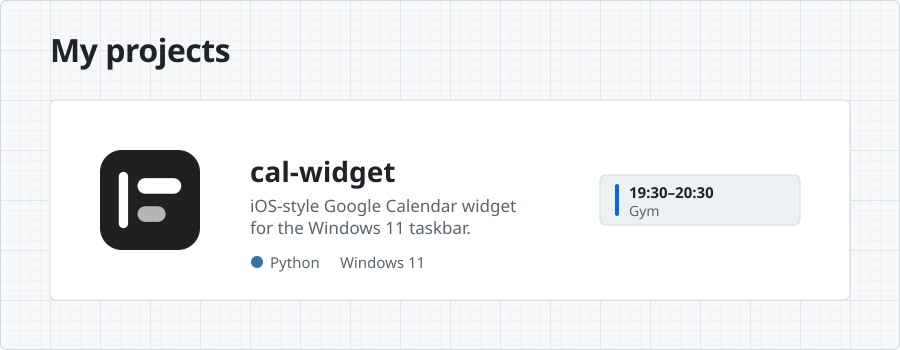

<picture>
  <source media="(prefers-color-scheme: dark)" srcset="assets/hero-dark.svg" />
  
</picture>

<picture>
  <source media="(prefers-color-scheme: dark)" srcset="assets/subjects-dark.svg" />
  
</picture>

<a href="https://github.com/zblt03/taskbits">
<picture>
  <source media="(prefers-color-scheme: dark)" srcset="assets/projects-dark.svg" />
  
</picture>
</a>
